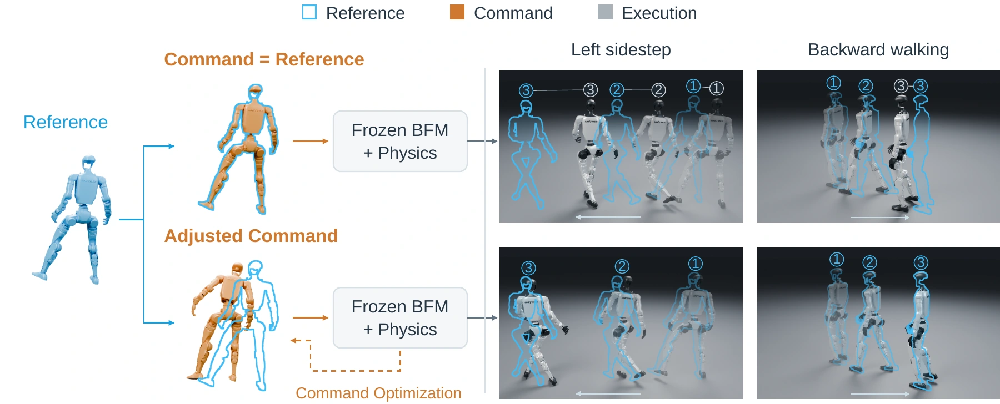
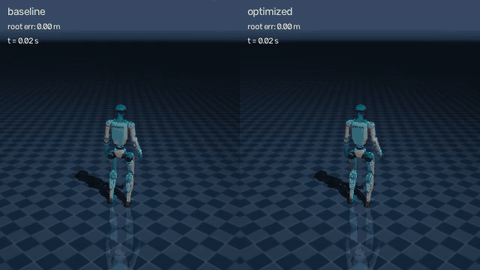
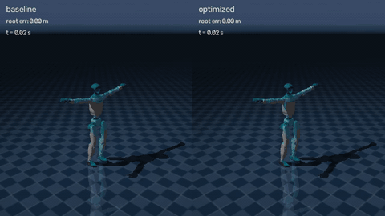
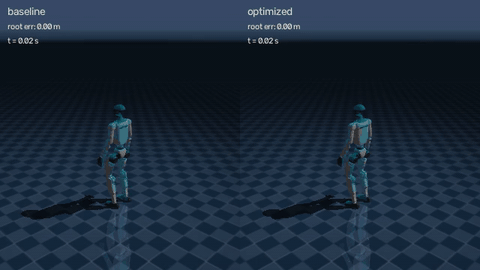
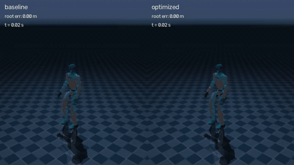

# Test-Time Compute for Humanoid Behavior Foundation Models

Weiji Xie†, Junsong Wu†, Zibo Zhou, Yueru Chen, Xingyi Wang, Zhenhua Xiong, Weinan Zhang, Chenjia Bai*


[Paper](https://arxiv.org/abs/2610.14896) · [Project page](https://bfmttc.github.io/)

We study how test-time compute can improve motion execution in humanoid behavior foundation models and how to scale it for the best performance.



This repository implements **Test-Time Command Optimization (TTCO)** and the
surrogate cost model from the paper. TTCO keeps a humanoid Behavior
Foundation Model (BFM) frozen and optimizes the motion commands it receives.
Candidate commands are evaluated in parallel closed-loop simulations of the BFM
and the robot. The selected command is executed for a short interval, and the
optimizer then replans for the next part of the same reference motion.

<table>
  <tr>
    <td align="center"></td>
    <td align="center"></td>
  </tr>
  <tr>
    <td align="center"></td>
    <td align="center"></td>
  </tr>
</table>


## Repository structure

The core code is composed of the following three packages:

| Package | Responsibility |
| --- | --- |
| `command_optimization` | **The runtime.** It loads reference motions, decodes candidate commands, evaluates them in simulation, runs receding-horizon execution, computes metrics, and renders videos. |
| `sampling_optimizers` | Sampling-based optimizers. Each one proposes candidates and updates its sampling distribution from their scalar costs. |
| `bfm_adapters` | Frozen BFM wrappers that build observations, run policy inference, keep history state, and map actions to PD commands. |

Additionally, [`experiments/surrogate_cost/`](experiments/surrogate_cost/README.md) provides code for the surrogate cost model and for reproducing the corresponding figures and tables in the paper.

## Quick start

You need Linux, Python 3.10 or newer, an NVIDIA CUDA GPU with a working
driver, Git, [uv](https://docs.astral.sh/uv/), and
[FFmpeg](https://ffmpeg.org/download.html). The locked environment includes
the CUDA 12 and cuDNN 9 user-space libraries.

Clone the repository and install the environment:

```sh
git clone https://github.com/Gamma-Robot/bfm_ttc.git
cd bfm_ttc
uv sync --frozen
```

Prepare the [G1 robot assets](docs/assets.md#g1-robot) from the official
HEFT repository once:

```sh
GIT_LFS_SKIP_SMUDGE=1 git clone --filter=blob:none --no-checkout \
  https://github.com/Axellwppr/motion_tracking.git outputs/assets/motion_tracking
git -C outputs/assets/motion_tracking sparse-checkout set sim2real/config/g1/assets
GIT_LFS_SKIP_SMUDGE=1 git -C outputs/assets/motion_tracking checkout \
  0d5ba31e33397f3543d350d98b637e26d92f470a
uv run python tools/prepare_g1.py outputs/assets/motion_tracking \
  artifacts/store/robots/g1-paper-model
```

The following example uses HEFT to track the included left-sidestep motion
and produces a video of the baseline and optimized executions. Prepare the
[HEFT-PMG checkpoint](docs/assets.md#heft-pmg) before running the example.

Optionally, check the configuration with `--dry-run`:

```sh
uv run bfm-ttc run configs/experiments/single_motion.yaml --dry-run
```

Run the baseline and optimized executions, then render the comparison:

```sh
MUJOCO_GL=egl uv run bfm-ttc run configs/experiments/single_motion.yaml \
  --device-index 0 --output-dir outputs/example
MUJOCO_GL=egl uv run bfm-ttc render outputs/example
```

The first run takes longer because it compiles the Warp kernels.
Afterwards, `outputs/example/` contains `report.json` with tracking metrics,
`paired_traces.npz` with command and execution traces, the trajectory exports,
and the rendered `comparison.mp4`.

The four SONIC clips above come from `configs/experiments/motion_set.batch.yaml`.
The [user guide](docs/user-guide.md) explains how to run your own motions,
batch experiments, optimization settings, and trajectory export.

## Acknowledgements


Robot simulation runs in parallel on the GPU with
[MuJoCo Warp](https://github.com/google-deepmind/mujoco_warp). We also thank the
authors of the GPU-accelerated sampling-based model predictive control projects
[SUMO](https://github.com/rai-opensource/sumo),
[DIAL-MPC](https://github.com/LeCAR-Lab/dial-mpc),
[SPIDER](https://github.com/facebookresearch/spider), and
[hydrax](https://github.com/vincekurtz/hydrax).
We thank the authors of [HEFT](https://github.com/Axellwppr/motion_tracking),
[TWIST2](https://github.com/amazon-far/TWIST2), and
[SONIC](https://github.com/NVlabs/GR00T-WholeBodyControl) for releasing the
pretrained behavior foundation models used in this work. Motion datasets use the [Any4HDMI v2 format](https://github.com/EGalahad/any4hdmi/blob/main/docs/dataset_format.md).

## License

The original BFM-TTC code is released under [Apache-2.0](LICENSE). The SPIDER
sampler keeps its upstream **CC BY-NC 4.0** license. Notices for the other
upstream code and assets are in [THIRD_PARTY_NOTICES.md](THIRD_PARTY_NOTICES.md).

## Contact

If you run into a problem, please open an
[issue](https://github.com/Gamma-Robot/bfm_ttc/issues). For collaboration,
feedback, or other questions, contact:

- Junsong Wu: [jason-w@sjtu.edu.cn](mailto:jason-w@sjtu.edu.cn) or via Weixin (`Wujunsong0818`)
- Weiji Xie: [xieweiji249@sjtu.edu.cn](mailto:xieweiji249@sjtu.edu.cn) or via Weixin (`shisoul`)
- Chenjia Bai (Corresponding Author): [baicj@chinatelecom.cn](mailto:baicj@chinatelecom.cn)

## Citation

If you find this work useful, please cite:

```bibtex
@article{xie2026testtime,
  title={Test-Time Compute for Humanoid Behavior Foundation Models},
  author={Xie, Weiji and Wu, Junsong and Zhou, Zibo and Chen, Yueru and
          Wang, Xingyi and Xiong, Zhenhua and Zhang, Weinan and Bai, Chenjia},
  journal={arXiv preprint arXiv:2610.14896},
  year={2026},
  url={https://arxiv.org/abs/2610.14896}
}
```
